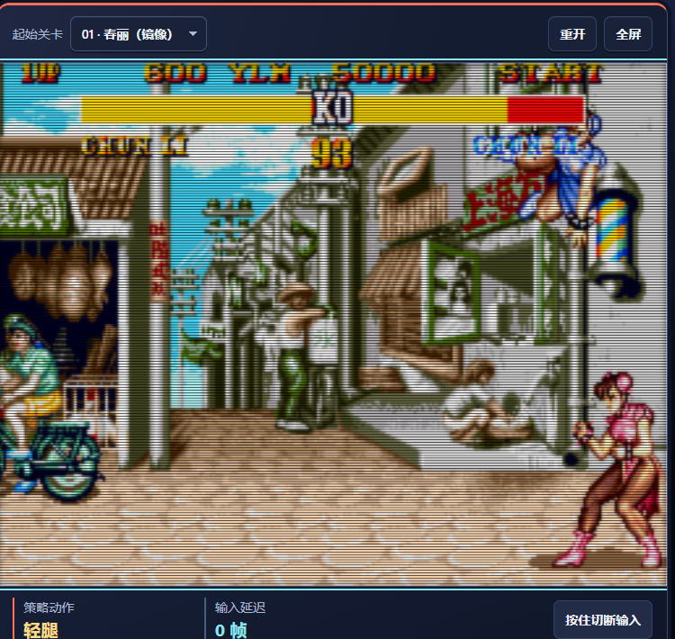
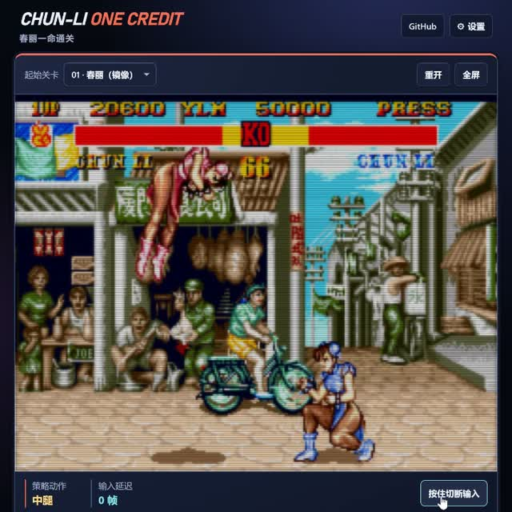
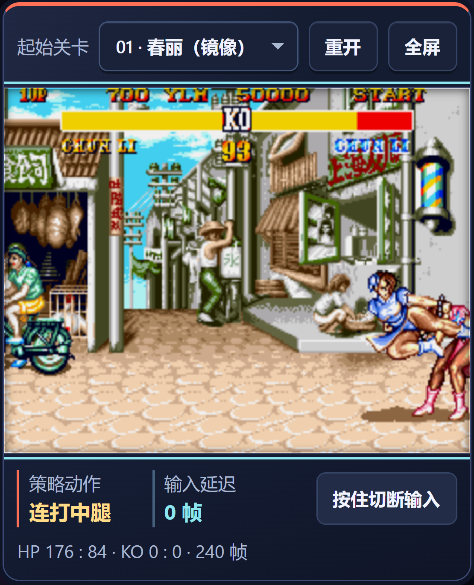
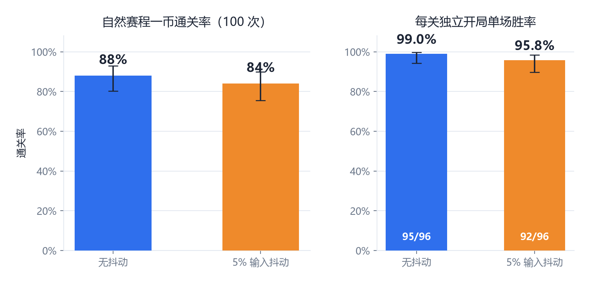
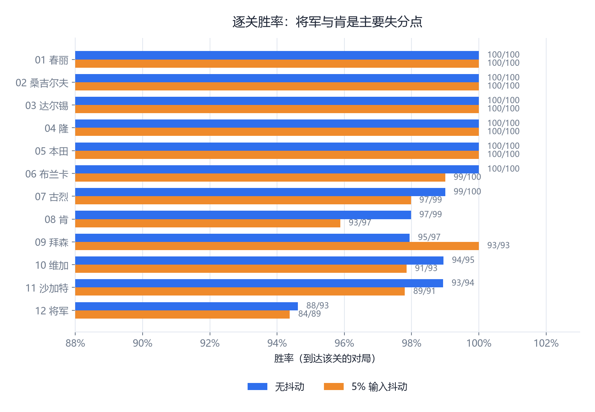
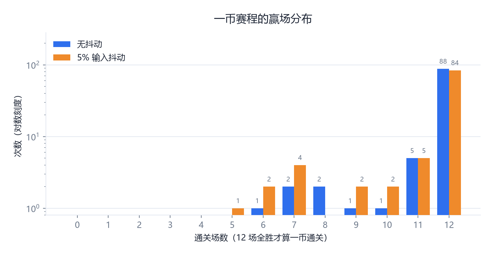

# Chun-Li One Credit · 春丽一命通关

同一个 PPO 策略操控春丽，在 Mega Drive 版《街头霸王 II：冠军特别版》中一币连打 12 场。最终权重在留出测试中，**无抖动通关 88/100，5% 输入抖动通关 84/100**。一币通关允许输掉小局，每场三局两胜，输掉整场则本次结束。

[网页实战](https://datou.github.io/ChunLi-OneCredit/) · [下载模型](https://github.com/Datou/ChunLi-OneCredit/releases/latest) · [制作存档](docs/savestates.md) · [训练与复测](docs/training.md)

## 网页实战

<p align="center">
  
</p>

<p align="center">
  <a href="docs/media/one-credit.mp4"></a>
  <br>
  <sub>点击封面观看 24 秒实机片段（浏览器里跑模拟器 + 策略）</sub>
</p>

<p align="center">
  
  <br>
  <sub>手机端：默认 2× 渲染，按住画面下方按钮可切断春丽的输入</sub>
</p>

网页用 WASM 模拟器实时运行同一份权重，并在浏览器本地校验 ROM（SHA-256）。打开页面后会静默预载模拟器、当前关卡存档和策略权重，选 ROM 后通常不到 1 秒即可开打；界面支持中英文切换（右上角 `EN` / `中文`）。桌面按屏幕像素 1:1 渲染以保证扫描线均匀，手机默认 2× 以控制开销。

## 训练结果

| 冻结权重评测 | 无抖动 | 5% 输入抖动 |
| --- | ---: | ---: |
| 自然赛程通关 | **88/100** | **84/100** |
| 每关独立开局的单场胜利 | 95/96 | 92/96 |



上图：左为 100 次自然赛程的一币通关率（误差线为 95% Wilson 区间），右为每关独立开局的单场胜率。



上图：12 名对手的逐关胜率，条末数字为「获胜/到达」。将军和肯是主要失分点，古烈与沙加特次之。



上图：一币赛程的赢场分布（对数刻度）。大多数失败发生在第 12 场，少数在第 6–11 场被终结。

图表由 `scripts/make_readme_charts.py` 从 `results/summary.json` 和 `results/one-credit.jsonl` 生成，改数据后重跑即可；重新出图需要 matplotlib。

连续赛程只在开始时加载第 1 关，之后由游戏推进，无中途读档或续币。连续赛程的 95% Wilson 区间分别为 80.2–93.0% 和 75.6–89.9%。5% 表示每个物理帧有 5% 概率将该帧输入延后 1–5 帧。表中统计来自 Python 锁步模拟；另有一次选定条件下的原生实时运行在 5% 抖动下连赢 12 场。[连续赛程逐场结果](results/one-credit.jsonl) · [评测摘要](results/summary.json) · [实时运行记录](results/realtime-clear.json)

## 从 Ultimate SFighterAI 到春丽的一币赛程

项目受 [Ultimate SFighterAI](https://github.com/LYiHub/pub-street-fighter-ai) 启发，沿用 PPO、NatureCNN、运动前景、血量奖励和 4 帧决策的思路。原项目训练隆挑战 12 关，也提供连续闯关评测。本项目以春丽自然连过 12 场为主要验收指标，并将输入延迟纳入训练和评测。

- **春丽动作与短时记忆。** 用 27 个春丽专用动作覆盖走位、普通攻击、连打和蓄力释放。网络接收 84×84 时序运动前景和最近 24 个已发出的动作。控制层用 RAM 判定前后方向，训练和赛程管理用 RAM 读取血量、比分等状态。
- **先覆盖各关，再练自然赛程。** 14 个环境轮换 12 关，通过开场随机走位和中盘快照扩展局面。之后从自然对战采集转场和中盘状态，混合不同输入抖动继续 PPO，重点复练古烈、肯、沙加特和将军。最终权重约训练 2.70 亿个决策步。
- **实时演示与评测各有入口。** Python 提供赛程评测与非阻塞原生实时调度。网页用 WASM 模拟器实时运行同一权重，默认 5% 抖动，按住画面下方的按钮可切断春丽的策略输入，松开后恢复。

## 运行项目

自备 USA 版 `Street Fighter II' - Special Champion Edition (USA).md`，3,145,728 字节。Python 训练和存档工具将它读作 `retro_data/StreetFighterIISpecialChampionEdition-Genesis/rom.md`。

```text
SHA-256  d9224423c80754a4ee945f7348d7478d56a134654a9389e02cd82caab76dddef
```

**观看网页。** 在网页中选择 ROM 即可实战。12 份开局存档随网页提供并按关自动加载。也可运行 `python -m http.server 8765 -d web` 本地打开。ROM 只在浏览器本地读取。

**训练与复测。** 已验证环境为 Python 3.8、Gym Retro 0.8、Gym 0.21、Stable-Baselines3 1.8、PyTorch 2.4、NumPy 1.24。先在新环境安装旧版 Gym 所用的打包工具，再安装项目依赖。CUDA 训练按本机设备选择 PyTorch 构建。

```bash
python -m pip install "pip<24.1" "wheel<0.40" "setuptools<66"
python -m pip install -r requirements.txt
```

手动抓取春丽镜像开场后，可用最终权重自动生成后续关卡存档。生成工具逐帧定位开场解锁，并重新读档验证双方满血、比分 0:0 和前进输入生效。[完整存档流程](docs/savestates.md)

## 许可

项目训练、策略和界面代码按 [Apache-2.0](LICENSE) 发布。随网页分发的 Genesis Plus GX 遵循其独立的[非商用许可](web/cores/LICENSE-Genesis-Plus-GX.txt)，对应源码为 [libretro/Genesis-Plus-GX 的固定提交](https://github.com/libretro/Genesis-Plus-GX/tree/b9c2316441978d4015ba30e9a95d9b0e6f8ee981)，[WASM 构建脚本](scripts/build_gx_wasm.ps1)随项目提供。随站附带的网页开局用于实战演示。游戏 ROM 由使用者自行提供。
